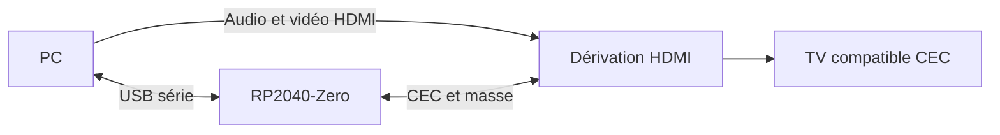

# Ajout du support HDMI‑CEC via une carte custom

Ce montage ajoute le CEC à une sortie HDMI de PC avec une **RP2040‑Zero**.
Le GPU fournit l’image et le son. La RP2040 reçoit les commandes du PC en USB
série et les échange avec le téléviseur sur le bus CEC de la liaison HDMI.

## Pourquoi ce montage

L’idée était de retrouver sur le PC le comportement du bouton Guide de la
Xbox. Une touche doit pouvoir réveiller la TV et sélectionner le bon HDMI.
À l’arrêt du PC, la TV doit passer en veille si elle affiche encore son entrée.
Les trois HDMI étaient déjà utilisés par le PC, la Xbox et la Switch. Le montage
reprend la liaison existante tout en conservant la 4K à 60 Hz avec HDR. Le réseau
de la TV peut rester désactivé.

## Pourquoi un GPU avec HDMI peut manquer de CEC

CEC (*Consumer Electronics Control*) est un bus de commande sur la **broche
13** du connecteur HDMI type A. Il transporte des ordres comme le réveil, la
veille et la sélection de source. Le protocole est facultatif dans la
spécification HDMI. La version HDMI et les capacités vidéo comme le 4K ou le
HDR ne renseignent donc pas sur la présence de CEC.
[Spécification HDMI, sections 4.1, 4.2.10 et 8.6](https://fpga.mit.edu/6205/_static/F24/default_files/CEC_HDMI_Specification.pdf)

Pour qu’un PC puisse envoyer du CEC nativement, il lui faut une interface
capable de piloter la ligne, une connexion entre cette interface et la broche
CEC et un pilote qui expose l’interface au système. Beaucoup de cartes
graphiques grand public n’exposent aucun contrôleur CEC exploitable. C’était
le cas de la sortie de la RTX 3080 sur la machine testée sous Linux. Certaines
plateformes intègrent un contrôleur natif. D’autres passent par un adaptateur
DisplayPort vers HDMI actif compatible avec le transport du CEC et dont la
broche CEC est câblée.
[Matériel PC et CEC chez Pulse‑Eight](https://support.pulse-eight.com/support/solutions/articles/30000053360/thumbs_down) ·
[Interfaces et adaptateurs CEC sous Linux](https://docs.kernel.org/admin-guide/media/cec.html)

## Principe et compatibilité



La console du firmware s’utilise depuis tout hôte capable d’ouvrir le port
USB série de la Pico. Le même montage est réutilisable avec d’autres TV
compatibles CEC. Il faut activer le CEC sur la TV, configurer l’adresse physique
de l’entrée choisie et vérifier les commandes que la TV accepte. Le démon
fourni dans les dotfiles automatise ces commandes sur **Linux avec KDE et
systemd‑logind**.

## Câblage

### Matériel

- Waveshare RP2040‑Zero avec un câble USB‑C de données, branché au PC.
- Adaptateur HDMI avec accès aux broches CEC et masse, placé sur la liaison
  HDMI entre le GPU et la TV. La liaison vidéo reste entre le GPU et la TV.

| Broche HDMI | Broche RP2040‑Zero | Fonction |
| --- | --- | --- |
| **13** | **GPIO 2**, marqué `2` | Signal CEC bidirectionnel. Le firmware relâche la ligne en mode entrée et la tire à zéro en mode sortie. |
| **17** | **GND** | Masse DDC/CEC. |
| USB‑C vers le PC | USB‑C de la carte | Alimentation et interface série. |

Faire les branchements hors tension. Seules les broches HDMI 13 et 17
partent vers la carte. Laisser libres les broches `5V`, `3V3` et les autres GPIO
de la carte. `SH` désigne le blindage du connecteur. Utiliser la broche 17
pour la masse CEC.

## Reconstruire et charger le firmware

Le [correctif](firmware/pico-cec-routing.patch) s’applique à
[Pico‑CEC 8a5d469](https://github.com/gkoh/pico-cec/tree/8a5d4690461ae4f676f69511c51063b860789ff7).
Il fixe le chemin HDMI par défaut à `1.0.0.0`, ajoute le décodage des trames de
routage, expose la dernière route observée dans `show cec` et répond à une
demande de source active sans émettre de réveil. Le nom HDMI est conservé
en mémoire non volatile de la RP2040.

Lancer les commandes depuis la racine des dotfiles. La compilation utilise
Git, CMake, le compilateur de la machine hôte, Python et la chaîne ARM
(`arm-none-eabi-gcc`, `arm-none-eabi-binutils`, `arm-none-eabi-newlib`).

```bash
patch_dir="$PWD/modules/panasonic-cec/firmware"
work_dir=$(mktemp -d)
git clone https://github.com/gkoh/pico-cec.git "$work_dir/pico-cec"
cd "$work_dir/pico-cec"
git checkout 8a5d4690461ae4f676f69511c51063b860789ff7
git submodule update --init FreeRTOS-Kernel pico-sdk tcli
git -C pico-sdk submodule update --init lib/tinyusb
git apply "$patch_dir/pico-cec-routing.patch"
cmake -S . -B build -DPICO_BOARD=waveshare_rp2040_zero -DCEC_PIN=2 \
  -DPICO_CEC_VERSION=8a5d469-gp2-hdmi1-routing
cmake --build build -j"$(nproc)"
```

Sur une carte neuve, maintenir **BOOT** en branchant son USB. Sur la carte
déjà équipée de Pico‑CEC, fermer toute application qui utilise son port
série puis utiliser `reboot bootsel` dans la console. Vérifier que le volume monté
s’appelle `RPI-RP2` et que son fichier `INFO_UF2.TXT` indique `Board-ID: RPI-RP2`. Copier
`build/pico-cec.uf2` sur ce volume. Il disparaît au redémarrage de la carte,
qui reparaît comme périphérique USB série.

## Console USB

### Régler l’entrée et le nom HDMI

Ouvrir le port USB série dans un terminal série. Sous Linux, par exemple,
utiliser `picocom -b 115200 /dev/ttyACM0` avec le port détecté, ou
`/dev/panasonic-cec` si la règle udev du module est installée. Si le démon
tourne, l’arrêter avant d’ouvrir la console.

L’adresse physique décrit le chemin jusqu’au téléviseur. Le firmware utilise
`1.0.0.0` par défaut. Pour HDMI 2 sur une liaison directe, utiliser par exemple
`set config physical_address 2000`, puis `save` et `reboot`.

Le nom HDMI est configurable. Les commandes suivantes utilisent `PC salon`
comme exemple.

```text
show version
show cec
show nvs
set config osd_name "PC salon"
save
show nvs
reboot
```

Si la TV garde l’ancien nom, rouvrir la console après le redémarrage et envoyer
`send f 84 10 00 04` pour annoncer une source de lecture en `1.0.0.0`.
Adapter les deux octets du chemin physique à l’entrée utilisée. Sur le montage
validé, le téléviseur redemande ensuite son nom à la source. Quitter la console
puis relancer le démon si nécessaire.

### Essais depuis la console série

Activer `debug on` pour voir les trames et utiliser `debug off` avant de
quitter. `show cec` donne l’adresse
physique du PC, son adresse logique et la dernière route connue. L’adresse
logique peut changer si un autre appareil utilise déjà la première disponible.

| Commande | Effet demandé |
| --- | --- |
| `send 0 8f` | Lire l’état d’alimentation de la TV. |
| `send f 85` | Demander l’annonce de la source active. |
| `send 0 04` puis `send f 82 10 00` | Réveiller la TV puis sélectionner l’entrée PC à l’adresse `1.0.0.0`. |
| `send 0 44 41` puis `send 0 45` | Appuyer sur Volume + puis relâcher. Remplacer `41` par `42` pour Volume − ou `43` pour Mute. |
| `send 0 36` | Demander la veille de la TV uniquement. Tester depuis l’entrée PC, avec le PC allumé. |

Les tests manuels ont aussi envoyé le volume absolu (`send 0 73 32` pour
50 %). Le niveau affiché doit être vérifié sur la TV. Le démon automatise le
réveil, la sélection d’entrée et la veille.

## Automatisation sous Linux avec KDE

Le module `panasonic-cec` écoute le raccourci du lanceur Plasma et l’arrêt
système pour envoyer automatiquement les commandes de réveil, de sélection
d’entrée et de veille.

### Utilisation quotidienne

| Action | Comportement |
| --- | --- |
| Appuyer sur **Super** (touche Windows) | Le lanceur KDE s’ouvre. La Pico envoie `Image View On` puis annonce l’entrée HDMI du PC, ce qui réveille la TV si nécessaire et sélectionne le PC. |
| Allumer le PC | Au premier démarrage du démon après le boot, celui-ci demande l’état de la TV et tente de la réveiller si nécessaire. Sur une machine avec ouverture automatique de session, cela se produit au lancement de KDE. |
| Choisir **Arrêter** dans KDE ou appuyer brièvement sur le bouton du boîtier configuré pour un arrêt normal | Le démon envoie la veille à la TV si elle est allumée et que la source suivie est celle du PC. Une source différente ou indéterminée laisse la TV allumée. |

Chercher **Démarrage automatique** dans les **Paramètres système de KDE**.
L’entrée s’appelle **Panasonic HDMI-CEC**. La désactiver ou la retirer pour les
prochaines connexions. L’arrêt et la relance immédiats se font depuis un terminal.

```bash
systemctl --user stop panasonic-cec.service
systemctl --user start panasonic-cec.service
```

### Installer le démon des dotfiles

Après avoir relié la carte à son port définitif, repérer son `/dev/ttyACM*`.
La version validée s’identifie en USB comme `cafe:4005` et expose le numéro
de série générique du firmware. Remplacer le périphérique ci-dessous par
celui effectivement détecté.

```bash
cec_port=/dev/ttyACM0
udevadm info --query=property --name="$cec_port" | grep -E '^ID_(VENDOR_ID|MODEL_ID|PATH)='
cec_path=$(udevadm info --query=property --name="$cec_port" | sed -n 's/^ID_PATH=//p')
dotctl info panasonic-cec --json
dotctl configure panasonic-cec --set "PANASONIC_CEC_USB_PATH=$cec_path"
dotctl plan panasonic-cec --json
dotctl apply panasonic-cec
dotctl status panasonic-cec
```

Le chemin du port est enregistré dans le dossier privé. La règle udev crée
`/dev/panasonic-cec` et donne accès à la session locale active. Si la carte
change de port USB, relever le nouveau `ID_PATH` et réappliquer le module.
L’application des dotfiles installe le démon, le service utilisateur, l’entrée
de démarrage KDE et la règle udev. Le flash reste une opération manuelle.

### Déroulement de l’arrêt et diagnostic

Le démon écoute l’action du lanceur Plasma sur D-Bus. Il garde la console série
ouverte, lit les routes CEC et peut récupérer la dernière route connue de la
Pico avec `show cec`, même après un redémarrage du logiciel côté PC.

Le service utilisateur survit à la fermeture de la session graphique. KDE
ferme son espace de travail avant de demander l’arrêt à logind. Le service
écoute `PrepareForShutdownWithMetadata` et reconnaît `poweroff`, la valeur
émise sur systemd 262.2, ainsi que `power-off`. Il garde un inhibiteur de délai
le temps d’interroger la TV et la source active. Si le PC est la source et
la TV est allumée, il envoie `Standby` à l’adresse logique 0 de la TV avant
de libérer le délai. Une coupure forcée du PC ne laisse pas ce délai.

```bash
systemctl --user status panasonic-cec.service
journalctl --user -u panasonic-cec.service -b
journalctl --user -u panasonic-cec.service -b -1
systemd-inhibit --list | grep -F 'Panasonic HDMI-CEC'
ls -l /dev/panasonic-cec
```

### Retirer l’automatisation ou le montage

Désactiver l’entrée **Panasonic HDMI-CEC** dans KDE, arrêter le service, puis
supprimer les fichiers utilisateur et la règle si le montage est retiré.

```bash
systemctl --user stop panasonic-cec.service
rm ~/.config/autostart/panasonic-cec.desktop ~/.config/systemd/user/panasonic-cec.service
rm ~/.local/libexec/panasonic-cec.py
systemctl --user daemon-reload
sudo rm /etc/udev/rules.d/70-panasonic-cec.rules
sudo udevadm control --reload-rules
```

Débrancher la carte USB pour retirer l’alias actif et déconnecter le câblage
CEC hors tension. Le nom HDMI persiste dans la RP2040 jusqu’à sa modification
dans la console.

## Montage validé et résultats

Essais réalisés sur **GeForce RTX 3080 → HDMI 1 d’une Panasonic TX‑55MZ800E**,
avec le firmware Pico‑CEC patché et CachyOS sous KDE Plasma.

Sur la TX‑55MZ800E, activer **Contrôle HDMI** dans **Paramètres → Chaînes et
entrées → Entrées → CEC**. Pour le 4K à 60 Hz HDR, utiliser le mode HDMI 2.0
validé sur l’entrée du PC. Le mode HDMI est un réglage distinct du CEC.
Voir aussi la [notice Panasonic](https://tda.panasonic-europe-service.com/docs/1524930969-6011-3C6A1174128470471F7279CE9A877DBCAA5D2426/pgrp001/pcat033/tx55mz800e/997958/TX-55MZ800E_TX-65MZ800E.pdf).

- **Arrêt réussi**. Le journal contient `Signal logind reçu, arrêt de type poweroff`,
  `entrée PC observée, envoi de la veille` et `Standby Display OFF (ACK)`.
  Arrêt réel et extinction de l’écran confirmés le 26 novembre 2026.
- **Autre entrée**. Le test avec la TV sur HDMI 3 a détecté la route `3000`
  et a laissé la TV allumée. Après sélection du PC, la route attendue est
  `1000` sur ce montage.
- **Source inconnue**. La TV peut répondre à la demande d’état d’alimentation
  sans répondre à la demande de source. Ce cas a expliqué un arrêt sans
  veille. Le journal détaille désormais la route et l’état de la TV.
- **ACK et écran**. La TV a déjà répondu `On` sur le bus après l’extinction
  physique de l’écran. L’ACK confirme la réception de la trame. L’observation
  du voyant ou de l’écran confirme l’effet réel.
- **Sans signal au rallumage**. Voir aussi
  [Récupération du signal TV HDMI](../hdmi-tv-recovery/) pour la liaison vidéo
  et le réglage HDMI 2.0 de cette Panasonic.
