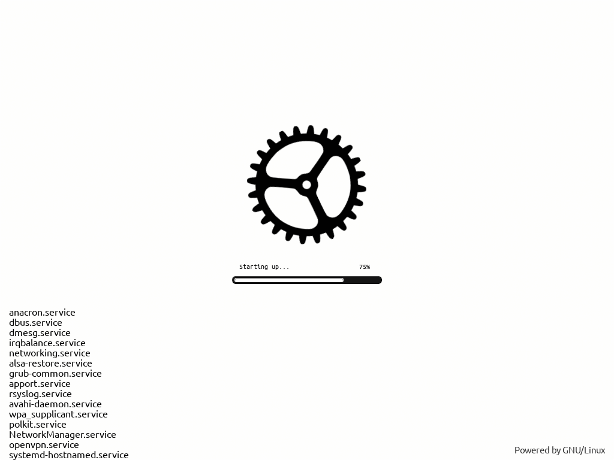

# Thème de démarrage Plymouth « Cogwheel spinner »



Thème *COGWHEEL-A-SPINNER-LOG-PGR-2-INVERSION V1.0* de DUKE93 (GPL-3.0+), embarqué ici
(~90 Ko) sous le nom court `cogwheel-spinner` :

- fichiers déployés dans `/usr/share/plymouth/themes/cogwheel-spinner/` ;
- `apply.sh` lance `plymouth-set-default-theme -R cogwheel-spinner` (écrit
  `Theme=cogwheel-spinner` dans `/etc/plymouth/plymouthd.conf` et régénère l'initramfs).

Seuls les fichiers utiles au thème sont gardés (pas les sources `SRC/`, vidéos et
`INSTALL.sh` de l'archive d'origine, prévu pour Debian/`update-alternatives`).

## Prérequis (à vérifier à la main sur une nouvelle machine)

1. Hook `plymouth` dans `/etc/mkinitcpio.conf`, après `kms`/`systemd` et avant
   `filesystems` (et avant `sd-encrypt` si le disque est chiffré, pour la saisie de la
   phrase de passe). Sur ryzen :
   `HOOKS=(base systemd autodetect microcode kms modconf block keyboard sd-vconsole plymouth filesystems)`
2. Paramètres noyau `quiet splash` (CachyOS les met par défaut ; avec Limine, voir
   `/etc/default/limine` puis `limine-update`).

`apply.sh` avertit si l'un des deux manque, mais ne modifie ni mkinitcpio ni le chargeur
de démarrage.

## Ancienne installation (ryzen)

Le thème avait été copié dans
`/usr/share/plymouth/themes/COGWHEEL-A-SPINNER-LOG-PGR-2-INVERSION_V1/` avec un sous-dossier
supplémentaire : le fichier `.plymouth` n'était pas à l'endroit attendu, donc
`Theme=COGWHEEL-A-SPINNER-LOG-PGR-2-INVERSION_V1` était ignoré et Plymouth retombait sur
`bgrt`. Après application du module, ce dossier peut être supprimé :

```sh
sudo rm -r /usr/share/plymouth/themes/COGWHEEL-A-SPINNER-LOG-PGR-2-INVERSION_V1
```
